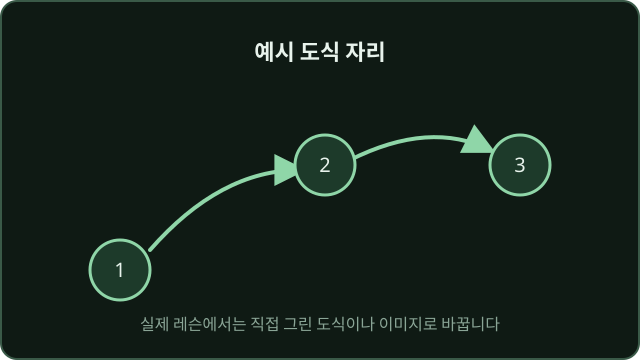

---
# 화면 개발용 예시(더미) 레슨입니다. 실제 내용은 출처를 바탕으로 다시 씁니다.
title: 어디서 시작해서 어떤 순서로 돌까?
goal: 내 상황에 맞는 시작 위치와 첫 클리어 순서를 스스로 고를 수 있다
order: 1
status: 공개
isExample: true
verifiedPatch: "예시"
review: 검수 전
summary:
  - 예시 요약 첫째 줄입니다. 실제 레슨에서는 가장 중요한 원칙을 한 문장으로 씁니다.
  - 예시 요약 둘째 줄입니다. 퀴즈에서 연습한 판단 기준을 다시 짚습니다.
  - 예시 요약 셋째 줄입니다. 다음 게임에서 바로 써 볼 행동 하나를 적습니다.
sources:
  - title: 예시 출처 1 (공식 자료 자리)
    url: https://example.com/official-source
    checkedAt: 2026-11-05
  - title: 예시 출처 2 (상위 티어 공개 콘텐츠 자리)
    url: https://example.com/coach-guide
    checkedAt: 2026-11-05
---

## 원칙

예시 문장입니다. 실제 레슨에서는 여기에 **패치가 바뀌어도 유지되는 판단 기준**을 씁니다.
이 문단은 화면에서 글이 몇 줄로 보이는지, 휴대폰 폭에서 줄바꿈이 자연스러운지 확인하려고 일부러 조금 길게 썼습니다.

예시 목록입니다.

- 예시 기준 하나: 실제 레슨에서는 판단에 쓰는 첫 번째 기준을 씁니다.
- 예시 기준 둘: 조건에 따라 달라지면 "대체로", "조건: ~"처럼 적습니다.
- 예시 기준 셋: 짧은 항목도 섞어 둡니다.

### 예시 소제목

소제목 아래 문단의 모양을 확인하기 위한 예시 문장입니다.

:::patch
예시 블록입니다. 실제 레슨에서는 수치, 타이밍, 루트처럼 **패치마다 바뀌는 정보**만 이 안에 씁니다.

- 예시 수치 A
- 예시 타이밍 B
:::

예시 마무리 문장입니다. 이제 상황 퀴즈로 넘어갑니다.
